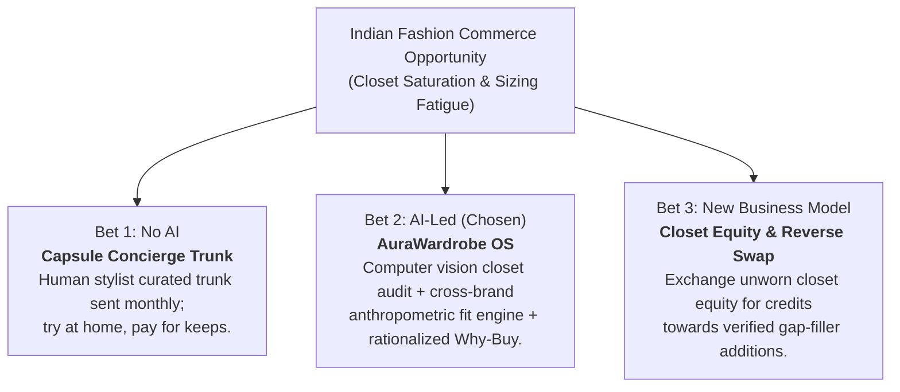

# Product Strategy Write-Up: AuraWardrobe AI
## Building a Next-Generation Fashion Commerce Operating System for India

**Target Segment:** Urban Young Working Professionals & Couples (Ages 23–30) in Tier-1 Indian Metros  
**Category:** Fashion E-Commerce, Wardrobe Intelligence & Anthropometric Sizing  
**Prototype Link:** [http://localhost:5173/](http://localhost:5173/)  
**Repository Path:** `/Users/adityasourav/Downloads/FashionCommerce`  

---

### Step 1: Choose a Segment — Who We Are Building For

#### The Specific Segment:
**Urban Young Working Professionals & Couples (Ages 23–30) residing in Tier-1 Indian Metros (Bengaluru, Mumbai, Delhi-NCR, Hyderabad, Pune).**

- **Demographics:** Salaried corporate/tech/creative professionals; personal annual income ₹8L–₹25L; monthly fashion spend ₹5,000–₹18,000.
- **Lifestyle Context:** Fast-paced hybrid work weeks (office 3 days, remote 2 days), active social calendars (weekend dining, cafe working, cocktail mixers), and regular cultural/festive family commitments (pujas, weddings, festival gatherings).
- **Core Paradox:** **"Closet Saturation vs. Style Scarcity."** They possess bursting wardrobes (40–80 garments), yet experience acute daily decision fatigue ("I have an overflowing cupboard but nothing to wear"). They shop online monthly across Myntra, Ajio, Zara, Snitch, and Amazon, but experience high disappointment, sizing inconsistency, and wardrobe imbalance.
- **Why this segment first?** They have high purchasing power, immediate disposable income, high digital fluency, and acute willingness to adopt camera/AI workflows to save time. Furthermore, their multi-occasion lifestyle (office smart-casual + weekend streetwear + traditional ethnic) tests the limits of traditional e-commerce catalogs.

---

### Step 2: Map the 5 Gaps with Evidence & Real User Research

```
+---------------------------------------------------------------------------------------------------+
| 5 STRUCTURAL GAPS IN INDIAN FASHION COMMERCE                                                      |
+---------------------------------------------------------------------------------------------------+
| 1. Sizing Roulette & Return Friction (30–40% return rate across Indian D2C & Western brands)     |
| 2. Cognitive Overload & Decision Fatigue (50,000+ infinite-scroll catalog tiles cause bounce)     |
| 3. Wardrobe Blindspots & Redundancy Purchases (Buying duplicate blues while core neutrals lack)    |
| 4. Social-to-Commerce Translation Gap (High Instagram inspiration vs. high multi-app friction)    |
| 5. Disjointed Cart Pairing (Manual cross-category search friction for matching footwear/artefacts)|
+---------------------------------------------------------------------------------------------------+
```

#### Field Evidence & User Interviews:

##### Interview 1: Aditya (Age 26, Senior Software Engineer, Indiranagar, Bengaluru)
- **Context:** Works at a high-growth fintech startup; shops online 2–3 times a month.
- **Direct Quote:** *"I ordered an 'L' from Snitch and it was skin-tight on my chest. Then I ordered an 'L' from Marks & Spencer and it felt like a parachute. My closet has six navy blue polo shirts and four black t-shirts because whenever I'm browsing in a hurry, I default to safe dark colors. When I needed to go to a family temple puja last month, I realized I had only one decent short kurta and literally zero traditional footwear to go with it."*
- **Key Pain Point:** High sizing variance between D2C and legacy brands; redundant comfort purchases; zero insight into what pieces complement what he already owns.

##### Interview 2: Ananya (Age 25, Creative & Brand Strategist, Koramangala, Bengaluru)
- **Context:** Digital marketing agency; loves experimenting with modern Indo-Western fusion wear.
- **Direct Quote:** *"I see amazing styling reels on Instagram—like a cropped Kashmiri embroidered shrug over wide-leg palazzos. But trying to find those exact pieces on Myntra or Ajio is exhausting. I have to search three different keywords, guess the fabric quality, and check reviews. Also, 90% of my bottoms are black trousers. I keep buying tops that only match black pants because I'm terrified an off-white palazzo will be see-through or fit awkwardly on my 5'3" frame."*
- **Key Pain Point:** Inspiration-to-cart friction from social media; bottom-wear risk aversion; lack of holistic outfit styling.

##### Interview 3: Rohan (Age 28, Senior Product Manager, HSR Layout, Bengaluru)
- **Context:** Recently relocated; rebuilding wardrobe for travel and leadership meetings.
- **Direct Quote:** *"Returning clothes is my single biggest weekend chore. Delivery agents come at random hours, or the exchange size is out of stock. If an app could look at my existing clothes, tell me: 'You already have enough dark polos, buy this oatmeal linen overshirt instead, and by the way in Snitch you are a Large but in Zara you are a Medium'—I would buy instantly."*
- **Key Pain Point:** Return logistics fatigue; desires high-confidence, low-volume curated recommendations over endless scroll.

---

### Step 3: Explain the Gaps — Why Current Incumbents Have Not Solved Them

1. **Conflict of Interest in Business Models (GMV & Ad-Revenue Trap):**
   Platforms like Myntra, Amazon, and Ajio monetize via search ads, sponsored brand placements, and transaction GMV. Their algorithms are optimized to maximize **Time-in-App (session length)** and **Impulse Add-to-Carts**. Building an engine that says *"You already own 4 dark polos; do not buy this one"* directly contradicts their core revenue incentive.
2. **The "Blind Closet" Limitation:**
   Incumbent platforms possess zero state knowledge of the customer's physical closet. They only see what the customer *ordered on their specific platform*. If a user bought their favorite jeans at a Levi's physical store, their kurta from FabIndia, and their sneakers on Amazon, Myntra operates in complete blindness.
3. **Subsidized Reverse Logistics Inertia:**
   Rather than solving pattern grading and cross-brand sizing at the root cause, major platforms treated 35% return rates as an unavoidable cost of customer acquisition, baking the cost into platform take-rates (25–35%) and seller margins.

---

### Step 4: Three Strategic Bets



#### Bet 1 (No AI): The Concierge Capsule Trunk
- **Concept:** A human stylist reviews a 10-minute user intake questionnaire, curates a physical trunk of 6 pre-measured garments from partner brands, and couriers it to the user's home. The user tries them on for 48 hours, keeps what they love, and sends back the rest.
- **Pros:** Zero tech risk, tactile try-on, high human trust.
- **Cons:** High operational CapEx, unscalable unit economics in India, inventory holding risk, reverse logistics cost eats gross margins.

#### Bet 2 (AI-Led) — CHOSEN BET: AuraWardrobe AI
- **Concept:** A camera-first wardrobe intelligence platform. The user uploads 4–6 ambient photos (or closet snapshots). Computer vision automatically segregates subjects, deconstructs garments, audits condition (Keep/Replace/Add), cross-maps physical proportions to exact Indian brand size frameworks, and recommends only **3 rationalized gap-fillers** with demographic social proof.
- **Pros:** Zero inventory risk (affiliate/headless commerce model), zero physical asset overhead, instant scalability, high user retention.

#### Bet 3 (New Business Model): Closet Equity Exchange
- **Concept:** Transform wardrobes from depreciating assets into liquid credit. Users deposit unworn tier-1 branded garments (e.g., Zara, Levi's) into the platform's authentication locker. They receive instant "Closet Credits" that can only be spent on purchasing missing wardrobe gap items from retail brand partners.
- **Pros:** Unlocks latent closet wealth, circular fashion sustainability narrative.
- **Cons:** Heavy reverse logistics, complex grading/fraud challenges, high capital intensity for warehouse inspection.

#### Why We Chose Bet 2 and What We Ruthlessly Cut for MVP:
We chose **Bet 2 (AI-Led)** because it solves the core psychological driver (decision fatigue & fit anxiety) with software margins and zero inventory liability.
- **What We Cut from MVP:**
  1. *Real-Time 3D Avatar Try-On:* Cut because mobile WebGL rendering produces uncanny-valley fabric draping that increases user skepticism rather than resolving it.
  2. *Unified Multi-Store Single-Page Checkout:* Cut because building headless checkout across Myntra, Amazon, and Ajio involves brittle reverse-engineered APIs. Instead, we generate pre-sized deep links and a unified cart staging interface.
  3. *Physical Garment Tag Barcode Scanning:* Cut because >70% of Indian users cut off scratchy wash-care tags immediately after purchase. Ambient camera vision is far more natural.

---

### Step 5: The Working Prototype
- **Live URL:** [http://localhost:5173/](http://localhost:5173/)
- **Core Tested Capabilities:**
  1. Multi-subject vision segregation (Aditya vs. Ananya) from uploaded real-world lifestyle photos.
  2. Interactive wardrobe health audit with condition scoring (1–10) and Keep/Replace/Add triage.
  3. Anti-decision fatigue "Why Buy" gap analysis with live links to Myntra, Amazon, and Flipkart.
  4. Cross-brand Indian sizing matrix (Snitch vs. Rare Rabbit vs. Zara vs. Levi's vs. FabIndia).
  5. Viral Instagram look cloner with 1-click bundle discount.
  6. Dynamic cart artefact pairing engine (matching footwear and accessories without keyword search).

---

### Step 6: Plan the First 30 Days

#### Go-To-Market Execution (Getting the First 100 Power Users):
```
+---------------------------------------------------------------------------------------------------+
| 30-DAY GO-TO-MARKET PLAYBOOK                                                                      |
+---------------------------------------------------------------------------------------------------+
| Days 1–10: Hyperlocal Tech Park Activation (Indiranagar / Bellandur, Bengaluru)                  |
|            • Partner with 3 co-working spaces (WeWork, BHIVE) for "Free 3-Min AI Wardrobe Audit". |
|            • Target 30 tech professionals; offer 1-on-1 fit diagnosis.                            |
+---------------------------------------------------------------------------------------------------+
| Days 11–20: "Closet Declutter & Gap Challenge" on WhatsApp / Instagram                          |
|            • Launch viral micro-campaign: Upload 3 photos -> Get your Wardrobe Imbalance Score.   |
|            • Onboard 50 female and male corporate users via organic word-of-mouth.                |
+---------------------------------------------------------------------------------------------------+
| Days 21–30: Affiliate & D2C Brand Partner Tie-ups                                                |
|            • Integrate affiliate tracking with Snitch, Rare Rabbit, and Myntra.                  |
|            • Reach 100 active users with >= 1 strategic purchase executed.                        |
+---------------------------------------------------------------------------------------------------+
```

#### What Can Go Wrong & Mitigation:
1. **Photo Lighting / Low Resolution:** In dim bedroom lighting, fabric texture is misclassified.  
   *Mitigation:* The UI provides real-time ambient quality checks and allows manual fabric confirmation.
2. **Privacy Apprehension:** Users may hesitate to share photos of themselves or bedrooms.  
   *Mitigation:* On-device face blurring option; explicit statement that images are processed strictly for silhouette and garment classification.

#### Metrics Framework:
- **North Star Metric:** **Wardrobe Gap Conversion Rate** (% of users who purchase an AI-recommended "Strategic Add" or "Replace" item within 14 days of audit). Target: **>18%** (vs. e-commerce average 2.5%).
- **Guardrail Metric:** **Fit-Related Return Rate**. Must remain **< 8%** (compared to industry standard 34%).
- **Kill Signal (When to Stop):** If after auditing their closet, **>60% of users still revert to typing keywords in Myntra's search bar**, or if the 30-day closet re-audit rate is **< 10%**, the hypothesis that users want structured wardrobe rationalization over impulse browsing is invalidated.
